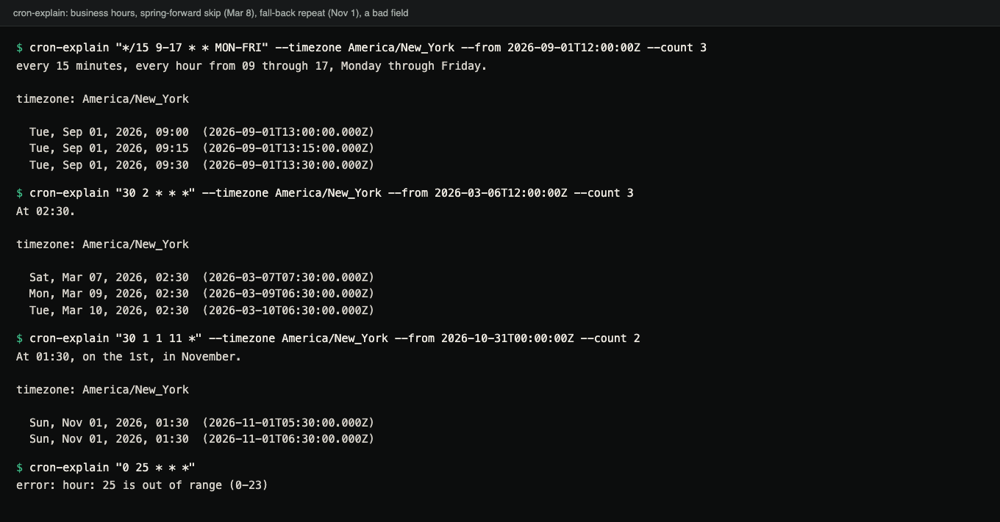
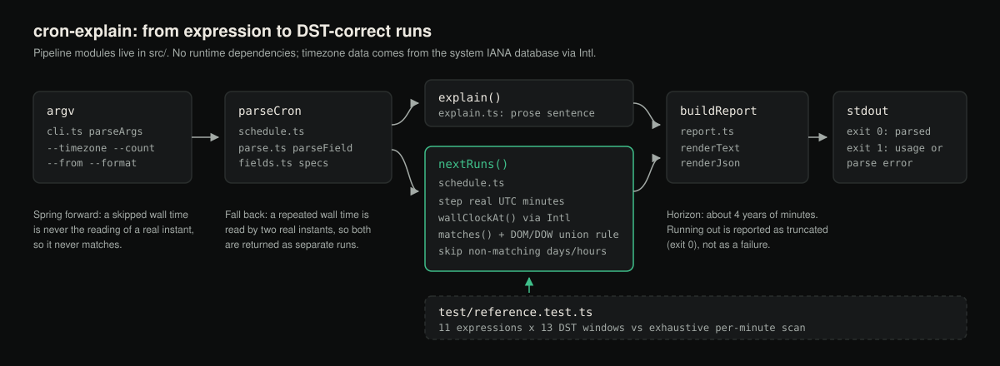

# cron-explain

A Node CLI and library that parses a 5-field cron expression, explains it in
plain English, and lists the next runs in a given IANA timezone. Runs near
daylight-saving changes are computed from real instants: a time skipped by
spring-forward never fires, and a time repeated by fall-back fires twice.
No runtime dependencies.

**Status:** v0.1.0. The CLI and library work and have 121 tests; CI runs them
on Linux, macOS and Windows with Node 20, 22 and 24. Not published to npm.

```console
$ cron-explain "*/15 9-17 * * MON-FRI" --timezone America/New_York --from 2026-09-01T12:00:00Z --count 3
every 15 minutes, every hour from 09 through 17, Monday through Friday.

timezone: America/New_York

  Tue, Sep 01, 2026, 09:00  (2026-09-01T13:00:00.000Z)
  Tue, Sep 01, 2026, 09:15  (2026-09-01T13:15:00.000Z)
  Tue, Sep 01, 2026, 09:30  (2026-09-01T13:30:00.000Z)
```

## Demo



Terminal capture of four real runs. The second one skips Sunday, March 8, 2026, because 02:30
does not exist in New York that day; the third returns 01:30 on November 1 twice, one hour apart.
The last is a usage error (exit code 1).

<details>
<summary>Same output as text</summary>

```console
$ cron-explain "*/15 9-17 * * MON-FRI" --timezone America/New_York --from 2026-09-01T12:00:00Z --count 3
every 15 minutes, every hour from 09 through 17, Monday through Friday.

timezone: America/New_York

  Tue, Sep 01, 2026, 09:00  (2026-09-01T13:00:00.000Z)
  Tue, Sep 01, 2026, 09:15  (2026-09-01T13:15:00.000Z)
  Tue, Sep 01, 2026, 09:30  (2026-09-01T13:30:00.000Z)

$ cron-explain "30 2 * * *" --timezone America/New_York --from 2026-03-06T12:00:00Z --count 3
At 02:30.

timezone: America/New_York

  Sat, Mar 07, 2026, 02:30  (2026-03-07T07:30:00.000Z)
  Mon, Mar 09, 2026, 02:30  (2026-03-09T06:30:00.000Z)
  Tue, Mar 10, 2026, 02:30  (2026-03-10T06:30:00.000Z)

$ cron-explain "30 1 1 11 *" --timezone America/New_York --from 2026-10-31T00:00:00Z --count 2
At 01:30, on the 1st, in November.

timezone: America/New_York

  Sun, Nov 01, 2026, 01:30  (2026-11-01T05:30:00.000Z)
  Sun, Nov 01, 2026, 01:30  (2026-11-01T06:30:00.000Z)

$ cron-explain "0 25 * * *"
error: hour: 25 is out of range (0-23)
```

</details>

## How DST is handled

The search does no timezone arithmetic of its own. It steps through real
UTC minutes and asks `Intl.DateTimeFormat`, which uses the IANA database in
your Node build, what the wall clock reads in the target zone at each one.
A minute matches if that reading matches the expression. Both DST edges
follow from this without special cases:

- **Spring forward.** A skipped wall time (2:30 AM on the change day in New
  York) is never the local reading of any instant, so it never matches.
- **Fall back.** A repeated wall time (1:30 AM) is the reading of two
  instants an hour apart, so both are returned as separate runs.

To stay fast on sparse schedules, the search jumps over days and hours that
cannot match and re-reads the clock after each jump.

## How it works



Diagram (not a screenshot): from the command line to the explanation and the list of runs.

## Requirements

- Node.js 20 or newer (`engines.node` is `>=20`).
- Timezone data comes from the IANA database built into your Node/ICU
  build, so results for a zone are only as current as that data.

## Install

This tool is **not published to npm**. The `cron-explain` package on the npm
registry is an unrelated project by another author, so `npm install
cron-explain` or `npx cron-explain` will not give you this tool. Install from
a clone:

```console
git clone https://github.com/hellpuffyt/cron-explain
cd cron-explain
npm ci && npm run build
npm link        # puts `cron-explain` on your PATH (or: node bin/cron-explain.js)
```

## How the DST claim is tested

`test/reference.test.ts` compares `nextRuns` against an exhaustive reference
that reads the wall clock at *every* UTC minute, for 11 expressions across 13
spring-forward/fall-back windows (hour-aligned, midnight transitions in
Santiago and Havana, Lord Howe's 30-minute DST, Chatham's :45 offset, the
southern hemisphere, and a no-DST zone). The search skips ahead for speed and
has to return exactly what the exhaustive scan returns.

## Cron syntax supported

Standard 5-field cron: minute, hour, day-of-month, month, day-of-week.
`*`, literal values, ranges (`a-b`), steps (`*/n`, `a-b/n`, `n/step`), and
comma-separated lists of any of those. Month and day-of-week accept
3-letter names (`JAN`, `MON`, case-insensitive). Day-of-week `0` and `7`
both mean Sunday, including as the end of a range (`1-7`, `MON-SUN`).
When both day-of-month and day-of-week are restricted (neither is a bare
`*`), a day matches if either field matches. That is how cron(8) behaves,
even though "AND" is the more obvious reading.

**Not supported, on purpose:** `L`, `W`, `#`, seconds, and wrap-around
ranges like `22-2`. These extensions (vixie-cron, Quartz) mean different
things in different implementations, and picking one reading would
misdescribe the schedule. They are rejected with exit code 1.

## Usage

```console
cron-explain "0 9 * * MON-FRI"
cron-explain "0 9 * * MON-FRI" --timezone Europe/London --count 10
cron-explain "0 9 * * MON-FRI" --from 2027-01-01T00:00:00Z --format json
```

`--count` defaults to 5, `--timezone` defaults to `UTC`, `--from` defaults
to now. Runs are always strictly after `--from`. Run `cron-explain --help`
for the full option list and `--version` for the version.

Exit codes: `0` on a successful parse, `1` on a usage error, an invalid
expression or an unknown timezone (the message goes to stderr). A truncated
result is still `0`: the search horizon (about four years of minutes) ran
out before finding `--count` runs. That happens for very rare schedules and
for impossible ones like day 31 in February:

```console
$ cron-explain "0 0 31 2 *" --count 2
At 00:00, on the 31st, in February.

timezone: UTC

no matching run found within the search horizon
```

`--format json` prints `expression`, `explanation`, `timeZone`, `runs`
(ISO-8601 UTC instants) and `truncated`. The fall-back case, where 01:30
happens twice, returns both real instants:

```console
$ cron-explain "30 1 1 11 *" --timezone America/New_York --from 2026-10-31T00:00:00Z --count 2
At 01:30, on the 1st, in November.

timezone: America/New_York

  Sun, Nov 01, 2026, 01:30  (2026-11-01T05:30:00.000Z)
  Sun, Nov 01, 2026, 01:30  (2026-11-01T06:30:00.000Z)
```

## Library use

After `npm run build`, `dist/` exports the functions the CLI uses (see
`src/index.ts`): `parseCron`, `explain`, `nextRuns`,
`buildReport`, `renderText`, `renderJson`, `matches`, `wallClockAt`,
`createFormatter`, the field specs, and `CronExplainError`. Because the
package is not on npm, make it importable in another project with
`npm link cron-explain` after the `npm link` step above.

```ts
import { explain, nextRuns, parseCron } from "cron-explain";

const cron = parseCron("0 9 * * MON-FRI");
explain(cron); // "At 09:00, Monday through Friday."
nextRuns(cron, new Date(), "Europe/London", 3); // { runs: Date[], truncated: boolean }
```

## Security

cron-explain parses one expression and formats dates. It reads no files and
makes no network calls. Report vulnerabilities privately as described in
[SECURITY.md](SECURITY.md).

## Development

```console
npm ci
npm test
npm run typecheck
npm run lint
npm run build
```

`npm run coverage` runs the tests with V8 coverage, as CI does. See
[CONTRIBUTING.md](CONTRIBUTING.md) before opening a pull request.

## License

MIT, see [LICENSE](LICENSE).
